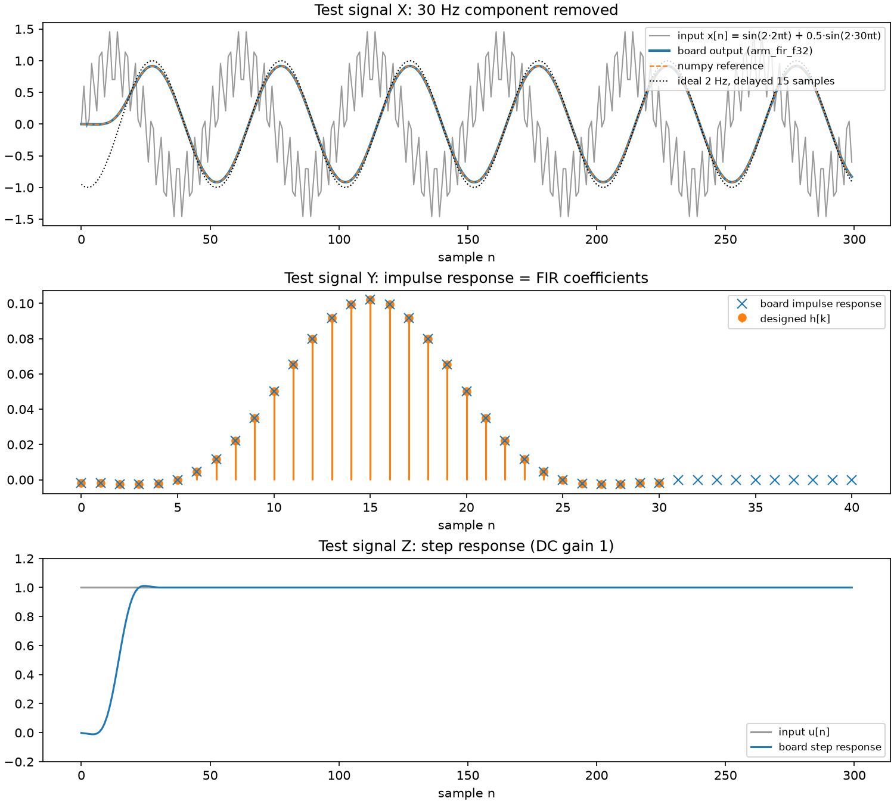
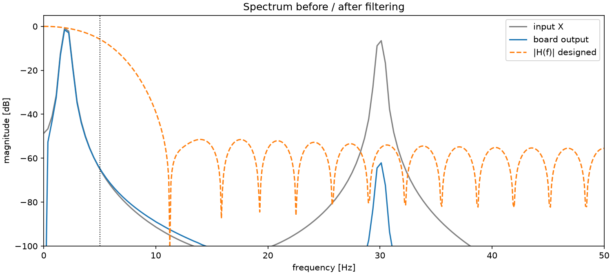
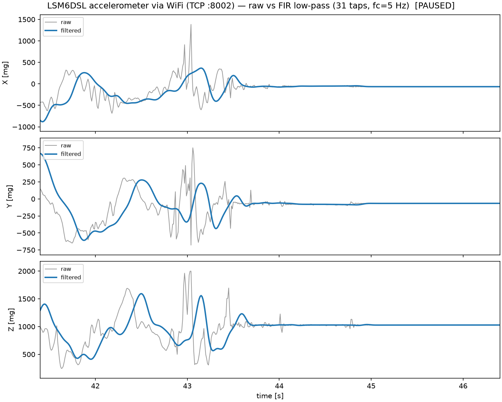

##### 連結
https://github.com/Alex-Hsu71/115-1-NTUEE-Embedded-System-Experiment/tree/master/HW7/HW7

### 系統架構
使用 B-L475E-IOT01A 上的 LSM6DSL 三軸加速度計，用 CMSIS-DSP 的 `arm_fir_f32` 做 FIR 低通濾波。系統以 CMSIS-RTOS2（FreeRTOS）分成三個 task：

```
TIM7 中斷 (100 Hz) ─thread flag─▶ SensorTask (High)        讀取加速度計 XYZ，每 10 筆打包
                                     │ rawQ
                                     ▼
                                  DspTask (AboveNormal)    arm_fir_f32 三軸濾波
                                     │ outQ（濾波前 + 濾波後）
                                     ▼
                                  CommTask (BelowNormal)   WiFi TCP 傳到 PC
```

| 項目 | 設定 |
|---|---|
| 取樣率 | 100 Hz（TIM7：80 MHz / 8000 / 100），LSM6DSL ODR 設為 104 Hz |
| 濾波器 | FIR 低通，31 taps，Hamming 窗，截止頻率 5 Hz |
| Block 大小 | 10 筆（100 ms），一次呼叫 `arm_fir_f32` 處理一個 block |
| 傳輸 | ISM43362 WiFi 模組，板子為 TCP client，PC 為 TCP server（port 8002） |

### Basic Problem
#### 濾波器設計
加速度計記錄的手持或身體動作大多在 5 Hz 以下，更高頻的成分主要是雜訊與震動，因此設計截止頻率 5 Hz 的低通濾波器。係數由 `tools/fir_design.py` 以 Hamming 窗 windowed-sinc 法計算（與 `scipy.signal.firwin` 相同），並正規化使 DC 增益為 1。

| 頻率 | 0 Hz | 2 Hz | 5 Hz | 10 Hz | 30 Hz |
|---|---|---|---|---|---|
| \|H(f)\| | 0 dB | −0.7 dB | −5.8 dB | −39 dB | −55.6 dB |

係數左右對稱，所以濾波器為線性相位，群延遲為 (31−1)/2 = 15 個樣本，即 150 ms。

#### 已知訊號驗證
開機時以及按下藍色 USER 按鈕時，SensorTask 會改送 300 筆已知測試訊號，取代感測器資料。測試訊號經過和真實資料完全相同的 queue 與 task 流程：

- X：sin(2π·2t) + 0.5·sin(2π·30t)，30 Hz 應被濾除，只留下 2 Hz
- Y：單位脈衝，輸出應等於 FIR 係數
- Z：單位步階，輸出應穩定在 1（DC 增益）

板子上同時用 double 精度的純 C FIR 對同一組輸入計算，比對 CMSIS-DSP 的結果；PC 端再用 numpy 重新計算一次。




| 項目 | 結果 |
|---|---|
| CMSIS-DSP 與板上 double 精度 FIR 的最大誤差 | 1.19 × 10⁻⁷ |
| 板子輸出與 PC numpy 的最大誤差 | 7.2 × 10⁻⁷（UART 只輸出到小數點後 6 位） |
| 脈衝響應與設計係數的誤差 | 4.8 × 10⁻⁷ |
| 步階響應最終值 | 1.000000 |
| 2 Hz 分量 | 1.000 → 0.918（−0.7 dB） |
| 30 Hz 分量 | 0.500 → 0.0008（−55.6 dB） |
| 三軸、各 10 筆的 FIR 執行時間 | 7064 cycles ≈ 88 µs，約為 10 ms 取樣週期的 0.9% |

時域上，30 Hz 的抖動被完全濾除，輸出與「延遲 15 個樣本的 2 Hz 正弦波」重疊。脈衝響應的每一點都落在設計係數上，代表 CMSIS 要求的係數反序存放方式正確。頻域上，實測的衰減量與設計的 |H(f)| 一致，證明濾波程式正確。

### Optional Problem 1
#### 三個 task 的排程
- **SensorTask（最高優先權）**：TIM7 每 10 ms 產生中斷，ISR 以 `osThreadFlagsSet` 喚醒 SensorTask 讀取感測器。I2C 讀取不在 ISR 中執行，ISR 只負責通知。讀滿 10 筆後放入 `rawQ`。
- **DspTask**：從 `rawQ` 取出 block，三軸各用一個 `arm_fir_instance_f32` 濾波，把濾波前後的資料一起放入 `outQ`。
- **CommTask（最低優先權）**：把每個 block 轉成文字（`S,n,x,y,z,fx,fy,fz`），以一個 TCP 封包送出。WiFi 傳送時的阻塞等待只會延遲最低優先權的 task，不會影響取樣時序。

CommTask 開機時先完成 WiFi 連線，再通知 SensorTask 啟動 TIM7，避免連線期間 queue 溢出。TCP 斷線時，每 3 秒重試一次；WiFi 未連上時，感測器資料改由 UART 輸出作為備援。

#### PC 端顯示
`tools/live_plot.py --tcp 8002` 作為 TCP server 接收資料，即時畫出三軸濾波前（灰）與濾波後（藍）的波形。



板子靜止時，原始訊號約有 ±1~2 mg 的雜訊，濾波後幾乎是平的。Y、Z 軸合成約為 √(737² + 675²) ≈ 1000 mg，即重力 1 g。板子移動時，濾波後的波形較平滑，並比原始訊號延遲約 150 ms。

#### 傳輸驗證
- PC 端 TCP server 顯示 `board connected from 192.168.0.112`，資料來源是板子在熱點上的 IP，而不是 COM port。
- WiFi 連線時，程式只在 UART 輸出狀態訊息，不輸出感測器資料，所以 PC 收到的感測器資料只可能來自 WiFi。

<!-- TODO：貼上 `netstat -an | findstr 8002` 的截圖（應看到 192.168.0.187:8002 ↔ 192.168.0.112 ESTABLISHED），或板子接行動電源、PC 仍收到資料的照片 -->
- 連續擷取 67.4 秒、共 6740 筆資料，樣本編號完全連續，`drops=0/0`，WiFi 傳送沒有遺失資料。


### 討論
1. **Block 處理**：`arm_fir_f32` 一次處理 10 筆資料，可以減少函式呼叫和 task 切換的次數，代價是增加 100 ms 的緩衝延遲。加上 FIR 本身 150 ms 的群延遲，從取樣到 PC 顯示約有 250 ms 以上的延遲，對觀察動作來說可以接受。
2. **Tap 數的取捨**：tap 數越多，過渡帶越窄、阻帶越深，但群延遲和運算量也越大。31 taps 在 30 Hz 已有 55 dB 的衰減，運算量只占 CPU 的 0.9%，延遲 150 ms 也還能接受。
3. **暫態**：FIR 啟動時，延遲線的初始值都是 0，所以前 30 筆輸出是暫態（步階響應需要約 30 個樣本才穩定）。每次切換訊號來源時，程式會重置濾波器狀態，避免前一段資料殘留在延遲線中。
4. **優先權設計**：取樣必須準時，所以讀感測器的 task 優先權最高；WiFi 傳送時間不固定，所以放在最低優先權。中間用 queue 作為緩衝，即使某次 WiFi 傳送較慢，也不會影響取樣。TIM7 的 ISR 會呼叫 RTOS API，因此中斷優先權必須 ≥ `configLIBRARY_MAX_SYSCALL_INTERRUPT_PRIORITY`（5）。
